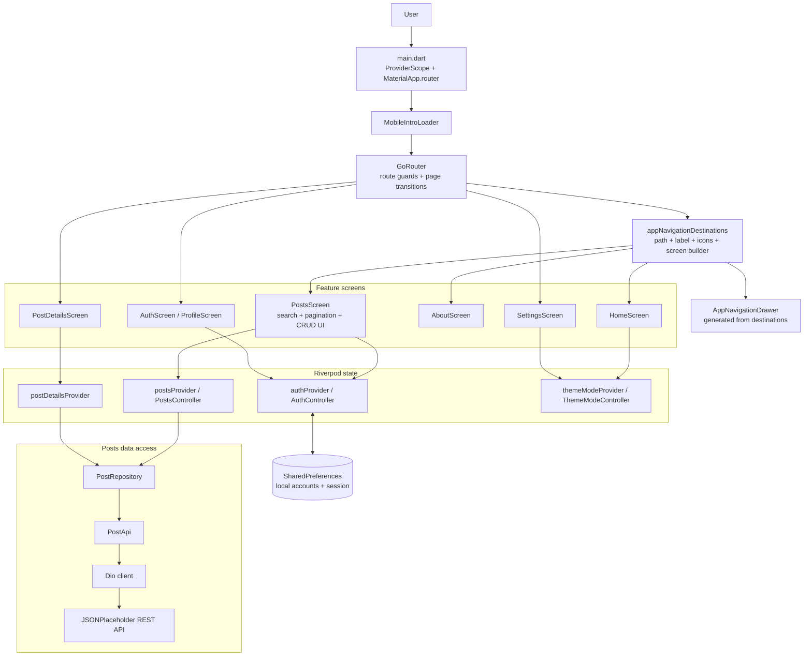
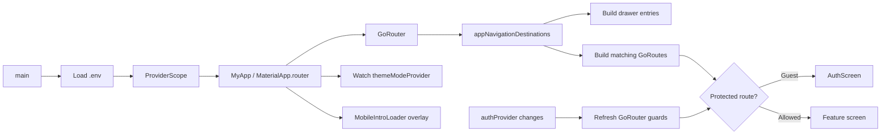
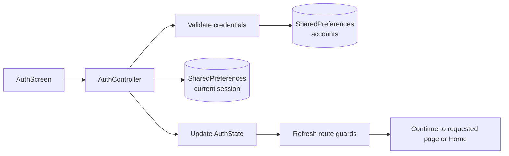
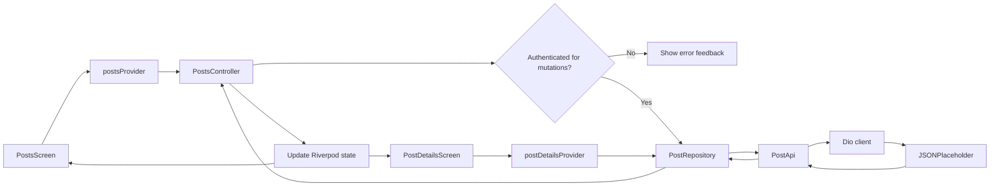

# Flutter Local Demo & Posts Management App

A feature-rich Flutter web and mobile application for viewing, searching, creating, editing, and deleting posts. The application uses **Riverpod** for state management, **SharedPreferences** for local account and session persistence, and a repository-controller architecture for REST API communication.

---

## 🚀 App Architecture & Workflow

### Architecture at a glance

The app is organized by feature. Presentation widgets read or invoke Riverpod
providers; application controllers coordinate work; repositories and API clients
handle post data access.



### Source layout

```text
lib/
├── main.dart
├── core/
│   ├── application/    # Shared app state, such as the theme
│   ├── network/        # Shared Dio client
│   ├── presentation/   # Shared UI, headers, settings, loading, animations
│   └── routing/        # Route definitions, guards, and transitions
└── features/
    ├── auth/
    │   ├── application/    # Auth state and controller
    │   └── presentation/   # Login, registration, and profile screens
    ├── navigation/
    │   └── presentation/   # Home, About, and dynamic navigation drawer
    └── posts/
        ├── application/    # Posts and post-details providers/controllers
        ├── data/           # Post model, repository, and API client
        └── presentation/   # Posts, details, forms, and reusable widgets
```

### 1. App Initialization & Session Restoration (`main.dart`)

- **Environment Configuration:** Loads application configuration.
- **Provider Scope:** Wraps the application in Riverpod's `ProviderScope`.
- **Theme Initialization:** Uses `theme_provider` to manage light and dark themes.
- **Authentication Hydration:** Uses `auth_provider` to restore local accounts and the active session through SharedPreferences.
- **Loading State:** Displays a progress indicator during initialization to prevent UI flickering.
- **Application Startup:** Displays the main application after initialization is complete.

### 2. Navigation & Routing

- **Landing Page:** Starts at `HomeScreen`, featuring a welcome section and quick actions.
- **Drawer Navigation:** `AppNavigationDrawer` builds its destinations from the shared `appNavigationDestinations` registry. Add a destination there to register its drawer entry and route together.
- **Global App Bar:** `app_bar_actions.dart` provides theme switching and user avatar or login controls.
- **Authentication Navigation:** Users can navigate to the authentication screen to register or log in.
- **Post Details Navigation:** Selecting a post opens `PostDetailsScreen`.

### 3. Local Authentication & Registration (`AuthScreen`)

The application supports local registration, login, session restoration, and logout.

**Validation**
- Validates email formatting.
- Requires a password of at least six characters.
- Prevents submission when form validation fails.

**Local Storage**
- Stores registered account records using SharedPreferences.
- Stores passwords as salted hashes rather than plaintext.
- Preserves registered accounts after logout.
- Restores the active session after restarting the application.

**Demo Account**

| Field | Value |
|---|---|
| Email | `demo@example.com` |
| Password | `password123` |

The demo account is seeded on first launch.

**Authentication Behavior**
- Opening `AuthScreen` while already signed in redirects the user to `HomeScreen`.
- Logging out clears the active session without deleting registered accounts.
- Guests can view posts and post details.
- Authenticated users can create, edit, and delete posts through the application's UI.

### 🔐 Authentication Security

This application implements **demo-only local authentication** for learning and testing purposes.

- **Password storage:** Passwords are stored as salted hashes rather than plaintext. Security depends on the hashing algorithm and its implementation.
- **Local persistence:** Account records and the active session are stored using SharedPreferences. This storage is not designed to protect sensitive authentication data against a device or application compromise.
- **Client-side permissions:** Only signed-in users can access post creation, editing, and deletion through the application's UI. These checks do not provide server-side authorization.
- **Demo API limitations:** JSONPlaceholder does not authenticate users or enforce ownership and permissions for post operations. Requests can be sent directly to its API without signing in to the app.
- **Production requirements:** A production application should use a trusted authentication backend, secure password hashing on the server, appropriate session or token management, and server-side authorization for every protected operation.

**Important:** The local login system demonstrates an authentication workflow; it should not be treated as a secure production authentication solution. Password hashing does not make local account storage or client-side access controls secure by itself.

For password storage, use a purpose-built password hashing algorithm such as **Argon2id, scrypt, or appropriately configured PBKDF2** rather than a fast general-purpose hash such as plain SHA-256. Verify the actual algorithm implemented by the application before documenting it as a specific security feature.

### 4. Posts, Search, and Pagination (`PostsScreen`)

Posts follow a clean architectural pipeline:

`PostsScreen → Riverpod Controller → Repository → PostApi → REST API`

**Search and Filtering**
- Filter posts by Title or Body.
- Match text case-insensitively.
- Update results when the search query changes.
- Reset pagination to the first page when the query or search field changes.
- Display an appropriate empty state when no results match.

**Dynamic Pagination**
- Defaults to 10 posts per page.
- Supports page sizes of 5, 10, 20, and All.
- Provides previous-page and next-page controls.
- Displays a live result-count summary.
- Resets to the first page when the page size changes.
- Keeps pagination within valid boundaries when filtering reduces the result count.

Selecting **All** displays every matching post on a single page.

### 5. Post Details (`PostDetailsScreen`)

Selecting a post opens its details screen.

- Fetches the selected post using `/posts/{id}`.
- Displays the post title and body.
- Displays the post ID and user ID.
- Handles loading, success, and error states.
- Allows both guests and authenticated users to view post details.

### 6. Mutations: Create, Edit, and Delete

Authenticated users can manage posts through the CRUD workflow.

**Create Post**
- Open the Add Post form.
- Enter a title and body.
- Validate required fields.
- Submit the request through the controller and repository.
- Update the current list after success.
- Display success or error feedback.

**Edit Post**
- Open the edit form from the post action menu.
- Load the existing title and body.
- Validate the updated values.
- Submit the update request.
- Update the current list after success.

**Delete Post**
- Display a confirmation dialog.
- Submit the delete request.
- Remove the post from the current list after success.
- Recalculate pagination and result counts when necessary.

**Permissions and Feedback**
- Guests have read-only access through the application UI.
- Authenticated users can manage posts through the application's UI.
- Confirmation dialogs help prevent accidental deletion.
- Success and error messages communicate operation outcomes.
- The Riverpod controller updates the visible list after successful operations.

**Demo API limitation:** JSONPlaceholder simulates mutations but does not persist changes on its server. Successful mutations update the current application state; refreshing or restarting restores the original server data. The API does not enforce the application's local authentication permissions.

---

## 🔄 Application Data Flow

### Startup and navigation



### Authentication Flow



### Posts CRUD Flow



---

## 🛠️ Tech Stack

| Technology | Purpose |
|---|---|
| Flutter | Cross-platform UI for web and mobile |
| Dart | Application programming language |
| Riverpod | State management, providers, and controllers |
| SharedPreferences | Local account and session persistence |
| JSONPlaceholder | Demo REST API |
| Repository Pattern | Separation of data access and presentation logic |
| HTTP client | API communication |
| Flutter Material | UI components, dialogs, forms, and navigation |
| Environment configuration | API base URL configuration |
| Flutter Test | Unit and widget testing |

---

## 📁 Architectural Responsibilities

- **Screens:** Render application pages and coordinate user interactions.
- **Widgets:** Provide reusable UI components, forms, dialogs, and navigation elements.
- **Providers and Controllers:** Manage authentication, theme, search, pagination, and CRUD operations.
- **Repositories:** Encapsulate data-access logic and provide a consistent interface to controllers.
- **PostApi:** Handles HTTP requests and API response processing.
- **Models:** Represent posts and local account data.
- **Configuration:** Supplies settings such as the API base URL.
- **Tests:** Verify application behavior and prevent regressions.

Request flow:

`UI → Controller → Repository → PostApi → REST API`

Authentication flow:

`AuthScreen → Auth Provider → SharedPreferences → Updated Auth State`

---

## ⚙️ API Configuration

The application uses JSONPlaceholder as its default demo API.

```env
API_BASE_URL=https://jsonplaceholder.typicode.com
```

The API base URL should be loaded through the application's configured environment-loading mechanism.

**Important notes:**
- Restart the application after changing environment configuration.
- When running in Chrome, the API server must be reachable from the browser.
- Browser requests must comply with the API server's CORS policy.
- Environment values bundled into a client application are not secret. Never store API secrets or private credentials in environment configuration.

---

## ▶️ Run the Application

From the project root, run:

```bash
flutter pub get
flutter run
```

### Run in Chrome

```bash
flutter devices
flutter run -d chrome
```

If Chrome is not available as a Flutter device, verify your Flutter installation and web support configuration.

### Run Tests

```bash
flutter test
```

Run tests after changing authentication, pagination, post operations, or shared UI components.

---

## 🧪 Testing Checklist

- [ ] The application starts without initialization errors.
- [ ] The demo account can log in.
- [ ] Users can register with valid credentials.
- [ ] Invalid email addresses are rejected.
- [ ] Passwords shorter than six characters are rejected.
- [ ] The session is restored after restarting the app.
- [ ] Logout preserves registered accounts.
- [ ] The drawer navigates between Home and Posts.
- [ ] Light and dark theme switching works.
- [ ] Guests can search posts and view post details.
- [ ] Title and Body search work case-insensitively.
- [ ] Search changes reset pagination.
- [ ] Page sizes of 5, 10, 20, and All work correctly.
- [ ] Previous and next controls respect page boundaries.
- [ ] Authenticated users can create posts.
- [ ] Authenticated users can edit posts.
- [ ] Delete confirmation appears before deletion.
- [ ] Successful mutations update the current list.
- [ ] API failures display appropriate feedback.
- [ ] Refreshing restores the original JSONPlaceholder data.
- [ ] `flutter test` passes.

---

## ⚠️ Limitations

- JSONPlaceholder does not permanently store post mutations.
- Local authentication is intended for demonstration and learning.
- SharedPreferences is not a secure database for sensitive account information.
- Client-side permission checks cannot prevent unauthorized direct API requests.
- API requests may fail because of network issues or browser CORS restrictions.
- Local UI changes should not be confused with persistent server-side data.
- Password hashing alone does not make client-side authentication secure.

For production deployment, use a persistent backend with server-side authentication, authorization, validation, and secure session handling.

---

## 🎯 Project Goals

This project demonstrates practical Flutter development skills through:

- Clean separation of UI, state management, repositories, and API services.
- Riverpod-based application state management.
- Local registration, login, and session restoration.
- Reusable forms and validation.
- REST API integration.
- Search, filtering, and dynamic pagination.
- Create, read, update, and delete workflows.
- Responsive Flutter UI for web and mobile.
- Error handling and user feedback.
- Automated unit and widget testing.
